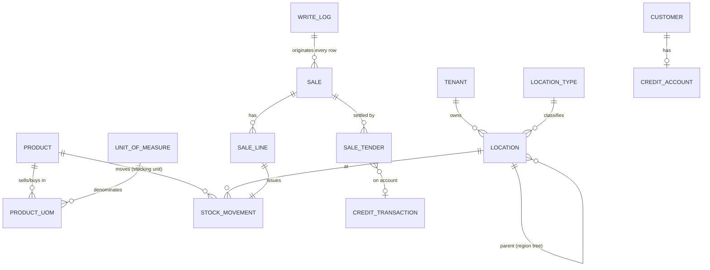

# 4. Core Data Model

This section fixes the schema spine: what a row is, how tenancy and idempotency are made
structural rather than conventional, and how the catalogue, stock ledger, sales, credit,
procurement and staff entities hang off it.

It also **resolves `open-questions.md` Q7** (fractional quantities and dual units of sale), which
blocks everything downstream of §4.4.

Everything here is DDL-flavoured sketch, not migration source. Types, names and constraints are
meant literally; formatting and helper syntax are not.

> **Revision note.** This section was adversarially reviewed on 2026-08-20 and revised. Eight
> blocking findings and nineteen lesser ones were accepted. The largest was that the section had
> been written as though §3 and §5 did not exist: it re-invented idempotency and the conflict queue
> under different names and weaker shapes, and its `sale_line` could not represent the tax the rest
> of the document says Ghana charges. Corrections are inline where short; the full disposition, the
> new tables (`sale_line_tax`, `cash_session`, `payroll_bureau_figure`) and the cross-section
> rulings are in **§4.17**. **Where §4.17 and the body differ, §4.17 governs.**

---

## 4.1 Shape of the model

Ten groups, roughly in dependency order:

| Group | Tables | Owner |
|---|---|---|
| Platform | `tenant`, `tenant_database`, `jurisdiction`, `tax_code`, `tax_rate` | `tenant-platform-engineer` |
| Write spine | `write_log`, `sync_conflict` | this section + `sync-architect` |
| Org | `location_type`, `location`, `document_number_range` | this section |
| Units | `unit_of_measure`, `product_uom` | **this section — Q7** |
| Catalogue | `product_category`, `product`, `attribute_definition`, `product_attribute`, `location_assortment` | this section |
| Pricing & tax | `price_list`, `price_list_item` | this section + `ledger-engineer` |
| Inventory | `stock_movement`, `stock_balance`, `movement_reason`, `stock_transfer`, `stock_count` | this section |
| Selling | `sale`, `sale_line`, `sale_tender`, `tender_method` | this section |
| Credit | `customer`, `credit_account`, `credit_limit_allocation`, `credit_transaction` | `credit-engineer` |
| Buying | `supplier`, `supplier_product`, `purchase_order(_line)`, `goods_receipt(_line)`, `delivery` | this section |
| People | `staff`, `user_account`, `staff_assignment`, `payroll_period`, `payroll_register_line` | this section + `rbac-security-engineer` |



`WRITE_LOG` is drawn once but is the parent of **every** tenant-owned row in the model. §4.2
explains why that is a foreign key and not a comment.

---

## 4.2 The universal row

Four properties must hold for every tenant-owned row, and none of them can be left to a
developer remembering: tenant ownership, a client-generatable identity, an idempotency key, and a
logical timestamp. We get all four from one base definition plus one DDL helper.

### 4.2.1 Domains

Domains exist so a lint rule and a `pg_type` query have something to grep for. They do not stop
someone writing `double precision` — the CI check in §4.2.5 does that.

```sql
CREATE DOMAIN app.money_minor AS bigint;   -- an AMOUNT, in the jurisdiction's minor unit
CREATE DOMAIN app.rate_e4     AS bigint;   -- a RATE (unit price, unit cost): minor units x 10^4
CREATE DOMAIN app.qty         AS bigint;   -- a scaled integer; the scale comes from the UoM
CREATE DOMAIN app.bp          AS integer   -- basis points; 10000 = 100%
  CHECK (VALUE BETWEEN -1000000 AND 1000000);
CREATE DOMAIN app.hlc         AS text COLLATE "C"
  CHECK (VALUE ~ '^[0-9]{13}-[0-9]{5}-[0-9a-f]{32}$');
```

`app.hlc` is a hybrid logical clock rendered fixed-width — 13-digit wall milliseconds, 5-digit
counter, **full 32-hex node** — so that **lexicographic order is causal order**. The `COLLATE "C"`
is load-bearing: under any linguistic collation the comparison is not byte order and the ordering
silently stops being total.

**The node was 4 hex digits and that broke totality.** §3.4.1 defines `node` as the full
`device_id` precisely because it makes the order total — *"no two events ever compare equal, so
every tie-break is deterministic and replayable rather than dependent on arrival order."* Truncating
to 16 bits gives roughly a coin-flip chance of a colliding suffix somewhere in a 300-device
platform; two such devices writing in the same millisecond with the same counter produce **equal**
HLCs, and §4.7.4 replays the movement ledger *in `hlc` order* to compute canonical unit cost. A tie
means the replay result depends on scan order and re-running it can produce a different cost of
goods sold. This domain is a **text projection of the composite defined in §3.4.1**, not a second
definition; the node component keeps all 128 bits. Per §3.4.1 the wall and counter components are
**server-stamped at ingest**; the device's assertion lives in `write_log.claimed_hlc`.

`money_minor` and `rate_e4` are both `bigint` and both integers. The distinction is semantic and
it matters: an *amount* is exact in minor units (`ADR-0004`); a *rate* needs sub-minor-unit
precision because GH₵2.375/metre is a real shelf price for 1.5mm cable and 237.5 pesewas is not an
integer. `ADR-0004` already permits this for percentages ("stored as basis points or scaled
integers"); §4.13 states the single point at which a rate becomes an amount. See the Concerns note
in §4.16 — this deserves one explicit line in `ADR-0004` rather than being inferred.

### 4.2.2 `write_log` — the unit of work

A sale is not one row. It is a header, three lines, three stock movements, a tender and a credit
charge. A retry after a flaky sync must be idempotent across **all** of them, so the idempotency
key belongs to the unit of work, not to each table.

**Corrected on review: there is one write registry, and `write_log.id` is the key.** The first
version carried a separate `idempotency_key text` described as "device-scoped, opaque to the
server" under a *tenant*-scoped unique index. Two devices minting a device-scoped value eventually
collide; the second to arrive violates the index and is treated as a duplicate — a **silently
dropped sale**, which §3.3.2 identifies as worse than a duplicate because a duplicate is visible.
Worse, if the server followed §3.3.3's `ON CONFLICT DO NOTHING` shape with `(tenant_id,
idempotency_key)` as the conflict target, the `write_log` row is swallowed and every business row's
composite FK points at a parent that was never inserted → FK violation → `4xx` → a tendered,
printed, cash-collected sale in a poison table. The full schema, with §3's registry merged in, is
in §3.3.2; the shape this section depends on:

```sql
CREATE TABLE app.write_log (
  tenant_id        uuid        NOT NULL REFERENCES platform.tenant(id),
  id               uuid        NOT NULL,              -- UUIDv7 from the device. THE idempotency key.
  origin           text        NOT NULL CHECK (origin IN ('DEVICE','SERVER')),
  hlc              app.hlc     NOT NULL,              -- server-stamped (§3.4.1)
  claimed_hlc      app.hlc,                           -- device assertion; UNTRUSTED
  device_id        uuid,                              -- NULL iff origin='SERVER'
  user_id          uuid,                              -- NULL only for scheduled server jobs
  location_id      uuid,                              -- from the verified session, NOT the payload
  op               text        NOT NULL,              -- 'sale.create', 'stock.adjust', ...
  schema_version   integer     NOT NULL,
  request_hash     bytea       NOT NULL,              -- JCS canonical form, hashed on the device
  response_body    jsonb,                             -- replayed verbatim; pruned at 90 days
  client_wall_at   timestamptz,                       -- device clock; untrusted, forensics only
  received_at      timestamptz NOT NULL DEFAULT transaction_timestamp(),
  CHECK (origin = 'SERVER' OR (device_id IS NOT NULL AND user_id IS NOT NULL)),
  PRIMARY KEY (tenant_id, id)                         -- per tenant, never global (ADR-0005)
);
```

`device_id` and `user_id` are **nullable with a CHECK**, not `NOT NULL`, because the earlier
version made server-derived rows impossible to write. §3.6 class #18 and §5.2.6 both require GL
postings to be derived server-side; so are the monthly facility-fee accrual (§5.6.2 #8),
depreciation (#13), year-end close (#16), statutory remittance (#9c), archival, and every conflict
resolution. None has a device and several have no user. The choice was to fabricate values or to
exempt the most sensitive rows in the system from the audit backbone; `origin` is neither.
Server jobs derive a **deterministic** `id` from `(op, natural key)` so a re-run is a no-op rather
than a double accrual (§3.11.7).

Every tenant-owned table then carries `write_id` with a **composite** foreign key back to it:

```sql
FOREIGN KEY (tenant_id, write_id) REFERENCES app.write_log (tenant_id, id)
```

Two consequences, both deliberate:

1. **Omitting the idempotency key becomes a foreign-key violation**, not a code review comment.
   There is no path that inserts a business row without first inserting a `write_log` row, and
   `write_log.id` *is* the key, so there is no separate field to forget and nothing to collide.
2. **Every FK between tenant-owned tables is composite on `tenant_id`.** A `sale_line` cannot
   reference another tenant's `sale` even with RLS disabled, because the constraint itself carries
   the tenant. RLS is the backstop (`ADR-0005`); this is the belt.

Cost: `write_log` is never pruned, and it is the fan-in point of the whole schema. At tenant #1's
FY10 volumes — 25 outlets, mostly single-digit-thousands of documents a day across the network —
this is single-digit millions of rows over ten years. Not worth optimising. A tenant with 500
outlets is a different conversation, and the tenant→database mapping in `ADR-0005` is the escape
hatch.

### 4.2.3 The base row

```sql
CREATE TABLE app.tenant_row_base (
  tenant_id  uuid        NOT NULL,
  id         uuid        NOT NULL,              -- UUIDv7: sortable, so index locality survives
  write_id   uuid        NOT NULL,
  hlc        app.hlc     NOT NULL,
  created_at timestamptz NOT NULL DEFAULT clock_timestamp(),  -- server receipt, not device time
  updated_at timestamptz NOT NULL DEFAULT clock_timestamp(),
  deleted_at timestamptz                                       -- soft delete; NULL = live
);
```

Tables are created through a helper, not by hand:

```sql
SELECT app.new_tenant_table('product', $$
  sku_code        text NOT NULL,
  name            text NOT NULL,
  ...
$$);
```

`new_tenant_table` emits `LIKE app.tenant_row_base INCLUDING DEFAULTS INCLUDING CONSTRAINTS`, the
`(tenant_id, id)` primary key, the composite FK to `write_log`, `ENABLE`/`FORCE ROW LEVEL
SECURITY`, the tenant-isolation policy, and a `(tenant_id, id)`-leading index. It is a migration
helper, not runtime magic — the generated DDL is checked into the migration file so a reviewer
reads real SQL.

**IDs are UUIDv7 generated on the device.** No sequences: two offline outlets cannot coordinate a
counter. v7 over v4 because it is time-ordered, so B-tree inserts stay at the right-hand edge
instead of dirtying random pages — with 25 outlets syncing bursts after a reconnection, that is the
difference between an append and a write-amplified shuffle.

### 4.2.4 Soft deletes and offline uniqueness

`deleted_at` is set; rows are never removed. Two rules follow:

- **Application reads filter `deleted_at IS NULL`. Sync does not.** A device must receive the
  tombstone or it keeps selling a deleted SKU forever. The delete travels; the filter is local.
- **Every "unique code" constraint is partial**, e.g.
  `CREATE UNIQUE INDEX ... ON app.product (tenant_id, sku_code) WHERE deleted_at IS NULL;`
  and **it cannot be checked offline.** Two outlets can both create customer `WALTER-01` on the
  same afternoon. That is not a bug to prevent, it is a collision to reconcile: the second insert
  to reach the server fails the index, the write is parked, and a `sync_conflict` row of kind
  `UNIQUE_COLLISION` goes to the review queue (§4.12). Human-facing codes are advisory labels; the
  UUID is identity.

**Documents and ledgers forbid soft delete**, not only ledgers:
`CHECK (deleted_at IS NULL)` on `stock_movement`, `credit_entry`, `journal_entry`, `journal_line`,
**and on `sale`, `sale_line`, `sale_line_tax`, `sale_tender`, `cash_session`, `goods_receipt`,
`goods_receipt_line`, `stock_count`, `payroll_register_line`** — every document that posts to the
GL. Corrections are compensating rows, never edits.

*Corrected on review:* leaving `sale` soft-deletable created a divergence nothing detects. Setting
`deleted_at` on a sale hides it from every sales report (reads filter `deleted_at IS NULL`) while
its `stock_movement` rows, tenders and journal entry survive, because *those* forbid soft delete.
Revenue disappears from one view and not the other, no conflict is raised, no compensating document
exists, and it surfaces months later as an unexplained gap between the P&L and the sales report.
The same class of failure applies to a soft-deleted `product` carrying a non-zero balance — the
`stock_on_hand` view sums its movements (correctly, since movements cannot be deleted) while every
stock report hides it, leaving phantom inventory value on the balance sheet that no stock list
shows. So: **soft-deleting a product with a non-zero balance, or any movement inside the retention
window, is refused.**

### 4.2.5 Row-level security and the CI guard

```sql
CREATE FUNCTION app.current_tenant() RETURNS uuid LANGUAGE sql STABLE AS $$
  SELECT nullif(current_setting('app.tenant_id', true), '')::uuid
$$;

CREATE POLICY tenant_isolation ON app.product
  USING      (tenant_id = app.current_tenant())
  WITH CHECK (tenant_id = app.current_tenant());
```

`app.tenant_id` is a GUC set per transaction from the verified JWT claim, server-side. It is never
read from a request body, a header, or a path parameter. If it is unset, `current_tenant()` returns
NULL, every predicate is NULL, and every query returns zero rows — it fails closed.

The rule is only real if it is checked, and the first version of this guard did not check the thing
it claimed. It proved RLS was **on**; it never proved RLS **isolates**. Four defects, each of which
lets a real leak through green CI:

- **It never inspected the policy expression.** `relrowsecurity` and `relforcerowsecurity` are
  booleans. A table with RLS enabled and a policy `USING (true)` — added during a debugging session,
  or emitted by a helper called with a bad parameter — passes and returns every tenant's rows.
- **`relkind = 'r'` misses partitioned tables (`'p'`).** `write_log` is never pruned and
  `stock_movement` is the highest-volume table in the schema; partitioning both is the obvious
  future migration, and the day it happens the parents silently leave the guard's scope.
- **It misses views entirely.** `app.stock_on_hand` is a view over an RLS table. Unless created
  `WITH (security_invoker = true)`, RLS is evaluated against the *view owner* — and an owner with
  `BYPASSRLS` returns all tenants.
- **The float guard was name-based.** Rejecting float types only on columns matching
  `%_minor|price%|…` catches violations that follow the naming convention. `double precision
  gross_margin`, `numeric discount_rate` and `real average_cost` all passed. A domain over `float8`
  passed too, because `atttypid` is the domain's OID.

Rewritten, as a set of **independent** assertions so a table can be exempt from one without being
exempt from all (§4.17.4):

```sql
-- (1) tenant contract, per assertion, over tables, partitioned tables, views and matviews
SELECT c.relname, v.assertion
FROM   pg_class c
JOIN   pg_namespace n ON n.oid = c.relnamespace
CROSS  JOIN LATERAL (VALUES
         ('has_tenant_id',  NOT EXISTS (SELECT 1 FROM pg_attribute a
                             WHERE a.attrelid=c.oid AND a.attname='tenant_id' AND NOT a.attisdropped)),
         ('rls_enabled',    c.relkind IN ('r','p') AND NOT c.relrowsecurity),
         ('rls_forced',     c.relkind IN ('r','p') AND NOT c.relforcerowsecurity),
         ('pk_leads_tenant',c.relkind IN ('r','p') AND (
                             SELECT a.attname FROM pg_index i
                               JOIN pg_attribute a ON a.attrelid=c.oid AND a.attnum=i.indkey[0]
                              WHERE i.indrelid=c.oid AND i.indisprimary) IS DISTINCT FROM 'tenant_id'),
         ('has_write_id',   c.relkind IN ('r','p') AND NOT EXISTS (SELECT 1 FROM pg_attribute a
                             WHERE a.attrelid=c.oid AND a.attname='write_id' AND NOT a.attisdropped)),
         ('security_invoker', c.relkind IN ('v','m') AND
                             NOT COALESCE((c.reloptions::text[] @> '{security_invoker=true}'), false))
       ) AS v(assertion, failed)
WHERE  n.nspname = 'app' AND c.relkind IN ('r','p','v','m') AND v.failed
  AND  NOT app.is_exempt(c.relname, v.assertion);   -- exemptions are PER ASSERTION

-- (2) the policy must isolate, not merely exist: exactly one permissive policy,
--     and its USING and WITH CHECK expressions must be the canonical predicate.
SELECT c.relname, 'policy is not the canonical tenant predicate' AS problem
FROM   pg_class c JOIN pg_namespace n ON n.oid = c.relnamespace
LEFT   JOIN pg_policy p ON p.polrelid = c.oid
WHERE  n.nspname='app' AND c.relkind IN ('r','p')
GROUP  BY c.oid, c.relname
HAVING count(*) FILTER (WHERE p.polpermissive) <> 1
    OR bool_or(pg_get_expr(p.polqual,      c.oid) IS DISTINCT FROM '(tenant_id = app.current_tenant())')
    OR bool_or(pg_get_expr(p.polwithcheck, c.oid) IS DISTINCT FROM '(tenant_id = app.current_tenant())');

-- (3) numeric types, inverted: NO float4/float8/real/money anywhere in app, and
--     numeric ONLY on a named, versioned allowlist. Domains resolved via typbasetype.
```

**The exempt list moves out of the database.** It was `app.tenant_exempt_table` — *a writable row in
the schema it guards*, which §1's rule states cannot exist (*"`app` — every tenant-owned table. No
exceptions, no exempt list, no discretion"*). "Adding to it requires a reviewer" was an assertion
with no mechanism: any migration, support script or compromised `app_rw` grant could silence the
guard with an `INSERT`. It is now a checked-in versioned file read by the CI harness, so an
exemption is a diff in a pull request. And because exemptions are per assertion, the tables that
genuinely need one — `write_log` (it *is* the referent, so no `write_id`), `stock_balance_current`
(a cache, no `write_id`), `conflict_review` (`resolution_write_id`, not `write_id`) — take
`has_write_id` alone. **No table may ever be exempt from `has_tenant_id` or `rls_forced`.** That is
not a policy, it is a hard-coded refusal in the harness.

---

## 4.3 Tenants, locations and location types

```sql
platform.tenant (
  id uuid PK, code text UNIQUE, name text,
  jurisdiction_id uuid NOT NULL,          -- exactly one (ADR-0007)
  currency_code   char(3) NOT NULL,       -- from the pack; 'GHS' for tenant #1
  money_scale     smallint NOT NULL,      -- from the pack; 2 for Ghana. NEVER assume 100.
  status text, onboarded_at timestamptz, template_id uuid
)
platform.tenant_database (tenant_id uuid PK, dsn_ref text, sync_service_ref text)
```

`tenant_database` resolves to the same cluster for every tenant today. It exists because
`ADR-0005` says promoting a tenant to a dedicated database must be a configuration change.

```sql
app.location_type (          -- TENANT vocabulary
  code text, name text,      -- tenant #1: FLAGSHIP / RDC / MICRO
  default_assortment_id uuid, default_headcount smallint
)

app.location (
  code text NOT NULL, name text NOT NULL,
  location_type_id uuid,                  -- NULL for grouping nodes
  parent_id        uuid,                  -- arbitrary-depth tree; composite FK on tenant_id
  kind text NOT NULL CHECK (kind IN ('OUTLET','WAREHOUSE','GROUP','TRANSIT','SUPPLIER_GAP')),
  is_active boolean NOT NULL DEFAULT true,
  opened_on date, closed_on date,
  timezone text NOT NULL
)
```

The distinction between `location_type` and `location.kind` is the whole of `ADR-0006` in two
columns, and getting it backwards is the failure mode the constitution names explicitly:

- **`location_type` is tenant vocabulary.** FLAGSHIP / RDC / MICRO are three rows created by
  tenant #1's template. Another tenant creates BRANCH / DEPOT. **No platform code ever reads a
  `location_type.code`.** `if (type.code === 'RDC')` is the same defect as `if (tenant === 'agyasei')`.
- **`location.kind` is platform structure**: does this node hold stock, can it sell, can it be a
  transfer endpoint. It is a closed enum because the platform genuinely branches on it.

Regions are `kind = 'GROUP'` nodes with no stock and no sales — tenant #1's six regions (Bono,
Northern, Ashanti, Upper East, Upper West, Savannah) become six GROUP nodes under one root, with
25 OUTLET nodes below them. One tree, no separate region table, arbitrary depth for the tenant who
wants country → region → district.

`kind = 'TRANSIT'` is how stock transfers stay honest offline; see §4.7.3.

**Human-facing document numbers** cannot come from a sequence. This section previously defined
`app.document_number_range` in parallel with §3.7.5's `sequence_block`; **that duplicate is deleted
and §3.7.5 owns the table** (`app.sequence_block`). The reasons matter beyond tidiness:

- The duplicate had **no `device_id` column and no uniqueness constraint**, so two devices at one
  location collided on the same `(location, doc_type)` row — and `next_value` was a mutable counter
  synced from devices, exactly the coordination §3.7.1 says is unresolvable offline.
- A device that is reflashed or has its local database cleared re-read a **stale** `next_value` and
  reissued numbers it had already printed. `UNIQUE (tenant_id, location_id, receipt_no)` then
  rejected the second sale, and §4.2.4's answer — park the write, open a `UNIQUE_COLLISION`,
  "human-facing codes are advisory labels" — is right for a customer code and **wrong for a receipt
  number already in a customer's hand**. The sale would sit unposted in a queue while the cash sat
  in the till.

Under §3.7.5: blocks are keyed `(tenant_id, sequence_key, location_id, device_id, block_start)`,
allocated server-side, **never reused and never reissued after a device reset**; `consumed_upto` is
device-local state that is *reported*, and any regression burns the block and opens a severity-1
review. Receipt numbers are unique per `(tenant_id, location_id)`, never network-wide — a single
global receipt sequence is exactly the coordination that offline outlets cannot do.

**Whether gaps and out-of-order issuance are acceptable is a jurisdiction-pack question, not ours.**
`ADR-0007` makes invoice numbering rules a pack value; block allocation *guarantees* gaps. §5.2.5
goes to real trouble to make GL entry numbering gapless because "why is journal 4471 missing" is a
fair auditor question — the identical question applies to invoices, and this section previously
asserted per-location uniqueness was sufficient without checking. Gap and ordering tolerance is
confirmed at gate **G2c** (§7.7).

---

## 4.4 Units of measure — resolving Q7

This is the section that unblocks the rest. The catalogue forced it: I re-derived the numbers from
`docs/source-of-truth/skus.csv` rather than quoting `ADR-0004`, and the shape is more specific than
"59 SKUs sell by weight".

| Population | Count of 219 | What it needs |
|---|---|---|
| Sold in a unit where a **fraction is meaningful** (Ton, Kg, Meter, Sqm) | **27** | sub-unit quantity precision |
| Carrying **two units on one stock balance** | **30** | stocking/selling split + conversion |
| Union of the two | **33** | both |
| Plus `Length` / `Roll` sold whole (discrete, but not "pieces") | +30 → **63** | just a named unit |

The commonly-quoted "59" is the union of everything that is not a plain countable piece. It is the
right order of magnitude and the wrong shape: **only 27 SKUs need fractional quantities, and 30 need
dual units — and they are mostly not the same SKUs.** Designing for "59 fractional SKUs" would have
put decimals on rebar, which is sold by the bar.

### 4.4.1 The model

```sql
app.unit_of_measure (
  code       text NOT NULL,     -- 'PIECE','BAG','KG','TON','METRE','SQM','LITRE','BAR_12M','ROLL','BOX','TRIP'
  name       text NOT NULL,
  dimension  text NOT NULL CHECK (dimension IN ('COUNT','MASS','LENGTH','AREA','VOLUME')),
  qty_scale  smallint NOT NULL CHECK (qty_scale BETWEEN 0 AND 6),
  is_discrete boolean GENERATED ALWAYS AS (qty_scale = 0) STORED
)
-- qty_scale is IMMUTABLE once any movement references the unit. Enforced by trigger:
-- changing a scale silently multiplies every historical balance by a power of ten.

app.product (
  ...,
  stocking_uom_id uuid NOT NULL      -- exactly one. The stock ledger is denominated in this.
)

app.product_uom (
  product_id uuid NOT NULL,
  uom_id     uuid NOT NULL,
  factor_num bigint NOT NULL CHECK (factor_num > 0),
  factor_den bigint NOT NULL CHECK (factor_den > 0),
  -- stocking units per ONE selling unit, in NATURAL units: factor_num / factor_den
  can_sell   boolean NOT NULL DEFAULT true,
  can_buy    boolean NOT NULL DEFAULT false,
  is_default_sell boolean NOT NULL DEFAULT false,
  tolerance_bp app.bp NOT NULL,             -- NO DEFAULT. see 4.4.4 — a default of 0 shipped
                                            -- the pilot with zero tolerance on every dual-unit row
  sort_order smallint NOT NULL DEFAULT 0,
  UNIQUE (tenant_id, product_id, uom_id)
)
-- exactly one is_default_sell per product: partial unique index
-- the stocking unit must exist as a product_uom row with factor 1/1
```

Three decisions in that shape, each with a reason:

**One stocking unit, chosen as the smallest thing a stocktaker can physically count.** Prefer the
discrete unit when one exists (rebar → the 12m bar; tiles → the box), otherwise the continuous one
(sand → the ton; cable → the metre). Not the other way round: if rebar were stocked in kilograms,
"how many bars are in the yard" would be a division that disagrees with the yard, and stock counts
are done by people counting bars.

**The conversion factor is a rational `num/den` pair, never a decimal.** This is not fastidiousness.
Rebar mass per metre is `d²/162` kg, so a 12m bar is `2d²/27` kg and **bars per tonne is exactly
`13500/d²`**:

| SKU | Diameter | `factor_num` | `factor_den` | Bars per tonne | As a decimal |
|---|---|---|---|---|---|
| 23 | 8mm  | 13500 | 64  | 13500/64  | 210.9375 |
| 24 | 10mm | 13500 | 100 | 135       | 135 |
| 25 | 12mm | 13500 | 144 | 93.75     | 93.75 |
| 26 | 16mm | 13500 | 256 | 13500/256 | 52.734375 |
| 27 | 20mm | 13500 | 400 | 33.75     | 33.75 |
| 28 | 25mm | 13500 | 625 | 21.6      | 21.6 |

Every one of those is exact as a rational. Stored as a 6-decimal factor, 8mm and 16mm are not, and
a 40-tonne order drifts by most of a bar. The pair costs one extra `bigint` column.

**Conversion happens in exactly one function**, `app.convert_qty(product_id, from_uom, to_uom, qty)`,
mirrored by one TypeScript function with the same property tests:

```
qty_stock_scaled = ROUND( qty_sell_scaled * factor_num * 10^stock_scale
                          / (factor_den * 10^sell_scale) )
```

Worked: 2.5 tonnes of 12mm rebar. TON scale 3 → `qty_sell_scaled = 2500`. BAR_12M scale 0.
`2500 * 13500 * 10^0 / (144 * 10^3)` = `33_750_000 / 144_000` = 234.375 → 234 bars.
Worked: 2 rolls of 1.5mm cable, ROLL scale 0, factor 100/1, METRE scale 3.
`2 * 100 * 10^3 / (1 * 10^0)` = 200 000 → 200.000 m. Exact, no rounding.

### 4.4.2 Which SKUs are actually dual-unit

The 30 dual-unit strings in `skus.csv` are three different things, and only the first is what
`product_uom` is for:

**A — genuine dual unit, one stock balance (23 SKUs).** One physical pile, two ways to price it.

| Catalogue string | SKUs | Stocking unit | Second selling unit | Factor (stocking per selling) |
|---|---|---|---|---|
| `Length (12m) / Ton` | 6 rebar | `BAR_12M` (scale 0) | `TON` | `13500/d²` — table above |
| `Roll / Meter` | 5 cable | `METRE` (scale 3) | `ROLL` | roll length, e.g. `100/1` |
| `Roll / kg` | 1 binding wire | `KG` (scale 3) | `ROLL` | roll mass, e.g. `20/1` |
| `Sqm / Box` | 5 tiles | `BOX` (scale 0) | `SQM` | `1/box_area`, e.g. `100/144` for 60×60 |
| `Sqm / Piece` | 1 paving blocks | `PIECE` (scale 0) | `SQM` | blocks per m² |
| `Ton / Trip load` | 4 aggregates | `TON` (scale 3) | `TRIP` | nominal truck capacity — see §4.16 |
| `Kg / Box` | 1 bolts & nuts | `KG` (scale 3) | `BOX` | box mass |

**B — pack break (3 SKUs).** Same mechanism, whole-number factors, no interesting rounding:
door hinges `Piece / Pair` (2/1), dust masks `Piece / Box`, sandpaper `Sheet / Pack`.

**C — not dual units at all (4 SKUs). The catalogue line is under-specified and must not be
imported as written:**

- **146** Waterproofing Compound, `Container / Bag`, `20L / 25kg` — a 20-litre bucket and a 25kg bag
  are two products, not two units of one.
- **160, 161** PPR and Copper "Pipes & Fittings", `Length / Piece` — a whole sub-catalogue on one
  line. Pipes sell by length, fittings by piece; they are different SKUs with different stock.
- **67** Aluminium Sliding Window, `Set/Sqm`, "Custom sizes", made-to-order — priced by area,
  delivered as a set, never stocked. This is `stock_tracking = 'NON_STOCKED'` (§4.5), not a
  conversion.

These four need the founder before import, and they are listed in §4.16.

### 4.4.3 Quantity scales

Fixed per unit, immutable once used:

| Dimension | Units | `qty_scale` | Smallest transactable |
|---|---|---|---|
| COUNT | PIECE, BAG, BAR_12M, BOX, SHEET, SET, ROLL, PAIR, TRIP | 0 | 1 |
| MASS | KG, TON | 3 | 1 g / 1 kg |
| LENGTH | METRE | 3 | 1 mm |
| AREA | SQM | 4 | 1 cm² |
| VOLUME | LITRE | 3 | 1 ml |

`qty_scale` is snapshotted onto every movement and every line (`qty_scale smallint NOT NULL`), so a
ten-year-old row is readable without joining to a definition that may have been superseded. The
trigger blocking scale changes and the snapshot are redundant on purpose: the snapshot is what
saves you if the trigger is ever dropped in a migration.

### 4.4.4 Where the rounding lands, and who decides

Converting to a **continuous** stocking unit (kg, m, m², L) is exact or rounds at the sixth decimal.
Nothing interesting happens.

Converting to a **discrete** stocking unit is where stock reconciliation is won or lost, and it is
not a rounding-mode question — it is a question about what physically left the yard. 2.5 tonnes of
12mm rebar computes to 234.375 bars. The customer is charged for 2.5 tonnes. The yard hands over
234 bars, or 235, or 234 plus an offcut, and **only the person at the yard knows which**.

So the schema records both facts independently and does not derive one from the other:

- `sale_line.qty_sell` = 2.500 TON — what was **priced**.
- `sale_line.qty_stock` = 234 BAR_12M — what **left the location**, and the only figure the stock
  ledger sees.
- `sale_line.factor_num/den` = 13500/144 — the conversion **snapshotted at the time of sale**, so
  correcting the factor tomorrow does not restate a historical document.

The POS computes 234.375, rounds half-up to 234, **shows it to the operator, and requires
confirmation** before the sale commits. `product_uom.tolerance_bp` bounds how far a confirmed
`qty_stock` may sit from the computed value; beyond it the line needs a permission the counter
staff do not hold (`CLAUDE.md` §2.6: no pricing overrides at outlet-staff level — same reasoning
applies to stock overrides) and raises a `CONVERSION_OUT_OF_TOLERANCE` review item.

That is the honest answer to Q7's third problem. A rounding mode in a config column would have
made the system quietly wrong 234 times out of 235; an operator confirmation makes it right, at the
cost of one extra tap on a sale that is already unusual.

**Two corrections, and the first would have broken the pilot on day one.**

1. **`tolerance_bp DEFAULT 0` meant "one extra tap" was actually "fetch a manager".** The template
   in §4.15 sets no tolerances and §4.16 asks the founder for conversion *factors*, not tolerances,
   so the pilot would have shipped with zero tolerance on all 26 dual-unit rows. 2.5 t of 12 mm
   rebar computes to 234.375 → 234; the yard hands over 235 because that is what a bundle contains;
   deviation is 267 bp > 0, so **every rebar-by-the-tonne sale at the flagship stalls for a manager
   at the yard.** That is how staff learn to sell rebar by the bar and key the tonnage as a
   discount. The column now has **no default** — authoring a `product_uom` row without stating a
   tolerance fails — and the template authoring checklist derives a sane starting value:
   `tolerance_bp = ceil(10000 / computed_qty_in_stocking_units)`, i.e. **one stocking unit of
   slack**, which for the 2.5 t rebar case is 43 bp on a 234-bar line and admits 235 but not 236.
   Tolerances join the founder confirmation list in §4.16.
2. **`conversion_confirmed_by` had no CHECK.** `is_price_override` two blocks above correctly
   carries `CHECK (NOT is_price_override OR override_approved_by IS NOT NULL)`; the confirmation
   §4.4.4 calls load-bearing was a UI promise with nothing behind it. Now:
   `CHECK (qty_stock = app.convert_qty(...) OR conversion_confirmed_by IS NOT NULL)` — expressed in
   practice as a stored `qty_stock_computed` column set by the same code path, so the CHECK is a
   plain column comparison rather than a function call in a constraint.

---

## 4.5 Catalogue

```sql
app.product_category (code, name, parent_id)     -- tenant tree: 12 categories, 54 sub-categories

app.product (
  sku_code        text    NOT NULL,
  name            text    NOT NULL,
  category_id     uuid    NOT NULL,
  stocking_uom_id uuid    NOT NULL,
  tax_code_id     uuid    NOT NULL,               -- into the jurisdiction pack (ADR-0002/0007)
  stock_tracking  text    NOT NULL DEFAULT 'STOCKED'
                          CHECK (stock_tracking IN ('STOCKED','NON_STOCKED')),
  is_sellable     boolean NOT NULL DEFAULT true,
  is_purchasable  boolean NOT NULL DEFAULT true,
  reorder_point_qty app.qty,                      -- in stocking units; Phase 2 alerts
  reorder_qty       app.qty
)

app.attribute_definition (code, name, data_type, is_reportable)
app.product_attribute (product_id, attribute_id, value_text, value_num)
app.location_assortment (location_id, product_id, is_stocked, reorder_point_qty)
```

**`tax_code_id` is mandatory and not defaulted.** A SKU without a tax code cannot be sold, because
the alternative is a receipt that is quietly not a statutory invoice.

**`stock_tracking = 'NON_STOCKED'`** covers the seven order-in and made-to-order lines in the
catalogue — culvert pipes, I-beams, roof trusses, sliding windows, burglar grilles, septic tanks.
They are sellable and purchasable, they post to the GL, they produce no stock movements and never
appear in a stock count. Without this flag every stocktake at the flagship starts with seven
permanent phantom variances.

**Merchandising vocabulary goes in `product_attribute`, not in columns.** `margin_tier`
(Low/Medium/High) and `turnover_speed` (Fast/Medium/Slow) are Agyasei's classification scheme. A
`margin_tier` column on `app.product` would be tenant #1's vocabulary in platform DDL — the same
mistake as an `RDC` branch, just quieter. They ship as two `attribute_definition` rows in the
template and drive reporting through a generic dimension.

**`location_assortment` is the `stocked_at` column, generalised.** Tenant #1's catalogue splits
84 All Tiers / 101 Flagship + RDC / 34 Flagship Only. The template applies this by location *type*
at onboarding; the stored rows are per *location*, so a manager can add one SKU to one micro-outlet
without inventing a fourth tier.

**Variants are deliberately not modelled.** There is no colour/size axis, no variant parent. A
product is a sellable, stockable thing. Assorted-colour emulsion paint is one SKU per volume,
because Agyasei counts buckets, not colours. The cost is that 15 catalogue lines carry a compound
`size_spec` (`1L / 4L / 20L`) and must be **expanded at template import into 32 products** — the
219 catalogue lines become **236 products**. That expansion is a one-off authoring step in the
template, not runtime behaviour, and it is listed in §4.15.

---

## 4.6 Pricing and tax

```sql
app.price_list (
  code text, name text,
  is_tax_inclusive boolean NOT NULL,
  currency_code    char(3) NOT NULL,
  priority         smallint NOT NULL,       -- resolution order, low wins
  location_id      uuid,                    -- NULL = whole tenant
  effective_from date NOT NULL, effective_to date
)

app.price_list_item (
  price_list_id uuid NOT NULL,
  product_id    uuid NOT NULL,
  uom_id        uuid NOT NULL,              -- price is PER SELLING UNIT
  unit_price_e4 app.rate_e4 NOT NULL CHECK (unit_price_e4 >= 0),
  min_qty       app.qty NOT NULL DEFAULT 0, -- volume break
  effective_from date NOT NULL, effective_to date,
  UNIQUE (tenant_id, price_list_id, product_id, uom_id, min_qty, effective_from)
)
```

**Retail and wholesale are two rows in `price_list`, not an enum.** There is no `kind` column with
`'RETAIL' | 'WHOLESALE'` and no code path that names either. Resolution is by rule: the customer's
assigned list, else the location's list, else the tenant default, all filtered to lists effective
on the transaction date, lowest `priority` wins. Tenant #1's template seeds two lists; a tenant
who wants a third for a government framework contract adds a row.

**`uom_id` in the key is the payoff of §4.4.** Rebar has a per-bar price and a per-tonne price on
the same list, and they are not required to be consistent with the conversion factor — a tonne is
usually cheaper per bar than a bar, and that is a commercial decision the model must be able to
express rather than derive.

**`is_tax_inclusive` is per list**, because counter retail is quoted inclusive and contractor
wholesale is quoted exclusive, and guessing produces a 15% error. §4.13 states the de-grossing
rounding.

Tax rates live in the jurisdiction pack, effective-dated, and are resolved by transaction date
(`ADR-0002`). `sale_line` snapshots both the resolved rate **and the id of the rate row**, so a
reprint six months after a rate change reproduces the original tax lines exactly rather than
re-deriving them.

---

## 4.7 Inventory

### 4.7.1 The movement ledger

```sql
app.stock_movement (
  -- tenant_row_base, with CHECK (deleted_at IS NULL)
  location_id  uuid NOT NULL,
  product_id   uuid NOT NULL,
  qty_delta    app.qty  NOT NULL CHECK (qty_delta <> 0),   -- SIGNED, in stocking units
  qty_scale    smallint NOT NULL,                          -- snapshot
  uom_id       uuid     NOT NULL,                          -- snapshot of the stocking unit
  reason_id    uuid     NOT NULL,                          -- app.movement_reason, tenant-editable
  source_kind  text     NOT NULL CHECK (source_kind IN
                 ('OPENING','SALE','SALE_RETURN','RECEIPT','RETURN_TO_SUPPLIER',
                  'TRANSFER_OUT','TRANSFER_IN','COUNT_ADJUST','WRITE_OFF','CORRECTION')),
  source_id    uuid,
  unit_cost_e4 app.rate_e4,          -- inbound only; issues take cost from the running WAC
  occurred_at  timestamptz NOT NULL, -- device time. UNTRUSTED (§3.4.2 device_wall_at). Display only.
  cash_session_id uuid,              -- NOT NULL for sale-sourced movements (§4.8a)
  business_date date NOT NULL,       -- FROM THE CASH SESSION, never from the device clock
  archived_at  timestamptz,          -- sync windowing only (§3.2.4); the ONE permitted UPDATE
  reverses_id  uuid,                 -- a correction is a compensating row, never an UPDATE

  -- The sign convention is stated once and then enforced. Previously the only
  -- constraint was "non-zero", so a source_kind='SALE' movement with a positive
  -- qty_delta increased stock and posted COGS backwards — indistinguishable from an
  -- ordinary row, summing into balances, and append-only so it can only be corrected
  -- by a compensating row someone has to notice is needed.
  -- Convention: OUTFLOW IS NEGATIVE.
  CONSTRAINT sm_sign CHECK (
       (source_kind IN ('SALE','TRANSFER_OUT','WRITE_OFF','RETURN_TO_SUPPLIER') AND qty_delta < 0)
    OR (source_kind IN ('OPENING','RECEIPT','SALE_RETURN','TRANSFER_IN')        AND qty_delta > 0)
    OR (source_kind IN ('COUNT_ADJUST','CORRECTION'))   -- genuinely bidirectional
  )
);

CREATE INDEX ON app.stock_movement (tenant_id, location_id, product_id, hlc);
CREATE INDEX ON app.stock_movement (tenant_id, business_date, location_id);
CREATE INDEX ON app.stock_movement (tenant_id, source_kind, source_id);

REVOKE UPDATE, DELETE ON app.stock_movement FROM app_rw;
-- plus a BEFORE UPDATE OR DELETE trigger that raises, because a future GRANT is one migration away
```

Append-only is not a preference here, it is what makes offline reconciliation possible at all. Two
outlets that both moved the same SKU while partitioned produce two rows that sum correctly in any
arrival order. A mutable `quantity_on_hand` column produces two writes where the later one destroys
the earlier, and no amount of conflict resolution recovers the lost movement.

`occurred_at` and `business_date` are separate because a sale entered at 00:40 after a late close
belongs to the previous trading day, and the GL cares which.

**Corrected on review: `business_date` comes from the open cash session, not from a clock.** The
earlier text derived it from *"the location's `timezone` and its configured day-close"* — which is
the device clock plus an offset plus a rule, and §3.4.2 states categorically that it comes from the
human-opened session precisely so that *"a tablet whose clock is a month out cannot post a sale to
the wrong accounting period."* Under the timezone derivation a drifted Android tablet posts to the
wrong GL period **and** prices against the wrong effective-dated VAT rate, because `business_date`
is the tax point. That is a wrong statutory invoice and a misstated period from one bad clock.
The entity that carries it is §4.8a, which this section had omitted entirely even though §3.6,
§3.2.2, §5.6.2 rules 11/11b and §5.7.4 all depend on it.

### 4.7.2 Derived balances

```sql
CREATE VIEW app.stock_on_hand AS
SELECT tenant_id, location_id, product_id, sum(qty_delta) AS qty_on_hand
FROM   app.stock_movement GROUP BY 1,2,3;

app.stock_balance (                       -- CACHE. Not truth.
  location_id, product_id,
  qty_on_hand app.qty NOT NULL,
  last_movement_hlc app.hlc NOT NULL,
  movement_count bigint NOT NULL,
  PRIMARY KEY (tenant_id, location_id, product_id)
)
```

`stock_balance` is maintained by trigger on insert and exists so the POS does not aggregate a
ten-year ledger to draw a stock badge. A nightly job asserts `stock_balance.qty_on_hand =
stock_on_hand.qty_on_hand` for every row and raises an operational alert on any divergence — the
cache being wrong is a bug in our trigger, and it should be loud, not silent. On the device the
same balance is computed locally from the movements the device holds, which are exactly its own
location's, so a device's balance is scope-correct by construction rather than by filtering.

**Negative on-hand is permitted.** A device cannot know the true network balance while offline, and
blocking a sale on a stale local number loses revenue and teaches staff to work around the system.
Negative balances raise a review item and a location-level alert. The cost is real: a persistently
negative SKU is either a missing receipt or theft, and someone has to look. That is a better
problem than a counter that refuses to sell cement that is visibly stacked behind it.

### 4.7.3 Transfers, and why TRANSIT is a location

```sql
app.stock_transfer (
  from_location_id, to_location_id,
  transit_location_id uuid NOT NULL,          -- kind='TRANSIT'. ONE PER SENDING LOCATION,
                                              -- durable. NOT one per transfer — see below.
  status text CHECK (status IN ('DISPATCHED','RECEIVED','PARTIAL','CANCELLED')),
  carrier_supplier_id uuid,                   -- ADR-0001: a haulier, not a vehicle
  dispatched_at timestamptz, received_at timestamptz
)

app.stock_transfer_endpoint (                 -- one row per (transfer, endpoint location)
  stock_transfer_id uuid NOT NULL,
  location_id uuid NOT NULL,                  -- denormalised so §3.2.3 can bucket it
  role text CHECK (role IN ('FROM','TO')),
  UNIQUE (tenant_id, stock_transfer_id, location_id)
)
```

A transfer produces movements in **two stages**: dispatch writes `TRANSFER_OUT` at the source and
`TRANSFER_IN` at the sending location's transit node; receipt writes `TRANSFER_OUT` at transit and
`TRANSFER_IN` at the destination. The destination may be offline for days — a micro-outlet in Bawku
frequently is — and with a single-stage transfer that stock is invisible to the whole network until
the receiving tablet reconnects. Modelling transit as an ordinary location means the stock is
always somewhere, the ledger always balances to zero across the network, and "what is on the road"
is a query rather than a reconciliation. The **transfer** is the dimension on the movement
(`source_kind='TRANSFER_*'`, `source_id = stock_transfer_id`), so commingling several open
transfers in one transit node loses nothing.

**Corrected on review: one TRANSIT node per *sending location*, not one per transfer.** `location`
is in the `tenant_reference` bucket, so it syncs to **every device of the tenant**. One node per
open transfer means thousands of location rows a year in a table this section otherwise describes
as "1 root + 6 GROUP + 25 OUTLET" — iterated by every location picker, every tree traversal, every
per-location report and, per §5.6.2 rule 16, every year-end close posting retained earnings per
location. It would also have had a dispatching device with outlet-staff permissions minting rows in
the platform's structural hierarchy. One durable node per stock-holding location is 25 rows, created
with the location.

**The GL follows the stock ledger, and §5.6.3 is corrected to match.** §5 put
`INVENTORY_IN_TRANSIT` at the *receiving* location while this section put the stock at a transit
node, so the two disagreed about where in-transit goods are and §5.5.4's per-location balance sheet
could not be reconciled to stock-on-hand per location. Ruling: **in-transit inventory posts at the
sending location's TRANSIT node**, with the ordinary `INTERLOC_CLEARING` pair, and TRANSIT nodes are
`is_trading = false`, `is_postable_location = true` — excluded from outlet P&L, included in
consolidation, so `consolidated = Σ locations` still holds. Shortfalls on receipt are a
`COUNT_ADJUST` against transit, which is exactly where the loss occurred; §5's argument that the
receiver investigates is satisfied by **routing the exception to the receiving location's manager**,
which is a queue-routing decision, not an accounting-location one.

### 4.7.4 Costing

**Weighted average cost per `(tenant_id, location_id, product_id)`**, recomputed by replaying the
movement ledger in `hlc` order. FIFO is rejected: it needs cost layers, and layers consumed in one
order on a device and a different order on the server do not converge. WAC is a single running
number that any replay of the same movement set reproduces.

The cost is stated plainly because it is not free: **a late-arriving movement restates cost, and
therefore restates margin, for movements after it.** A tablet that syncs on Thursday with Monday's
goods receipt changes Tuesday's COGS. The device shows a *provisional* margin; the server holds the
canonical one; reports carry an as-at marker. §4.16 flags what that means for a business tracking
gross margin to three decimal places.

**This contradicted §5 head-on, and the contradiction is now resolved.** §5.1 #9 says *"late-arriving
documents do not retro-restate posted COGS; the difference lands in a reported variance account"*;
this section says the ledger is replayed and cost is restated. Left as it was, the `INVENTORY`
account balance and `Σ(qty × WAC)` per location would diverge monotonically **by design**, with no
reconciliation anywhere in the document and neither section owning the gap. The ruling:

- **The stock ledger's replay is canonical for inventory *valuation*.** It converges; an
  arrival-order-dependent variance does not.
- **The GL does not retro-restate a posted entry** — §5.3's immutability rule is not negotiable.
- **The two are tied by a period-close inventory revaluation entry** posted *from* the subledger's
  canonical valuation, per location, so `INVENTORY` equals `Σ(qty × WAC)` at every close. That
  replaces `5190 COGS — cost variance` as a plug account with a real, explainable, reconciled
  entry.
- **A nightly assertion** compares `Σ(qty × WAC)` per location against the GL `INVENTORY` balance
  and alerts on divergence beyond the current period's un-revalued movement — loud, not silent,
  exactly as §4.7.2 treats the quantity cache. Value had no equivalent check and quantity did.
- **Whether moving-average is the right method at all remains `GL-Q2`** — an accountant's call,
  not an engineer's. What is settled here is the *mechanism* by which whichever method is chosen
  stays tied to the books.

Three things the earlier text left undefined and a replay cannot survive without:

- **Rounding of the running average.** `new_wac = (qty₀·wac₀ + qtyᵢₙ·costᵢₙ) / (qty₀ + qtyᵢₙ)` is a
  division and was in nobody's rounding list. It is **`rate_e4`, half-up, computed over a `numeric`
  intermediate and rounded once** — rounding point 8 in §4.13.
- **Cost of issue at zero or negative on-hand.** §4.7.2 deliberately permits negative on-hand and a
  micro-outlet selling ahead of an unsynced receipt is routine, not an edge. Rule: **the last known
  WAC for that `(location, product)`**; failing that, the last known WAC at any location; failing
  that, the most recent `supplier_product.last_price_e4`; failing all three, zero **and a
  `COST_UNAVAILABLE` review item**. Never silently zero — a zero-cost issue is a 100% gross margin
  on that line and, under §5's no-restatement rule, a permanent misstatement.
- **Replay order must be total**, which is why the HLC node keeps all 128 bits (§4.2.1).

Landed cost (freight, offloading — material on cement) is **not** allocated to unit cost in Phase 1.
It posts as a period expense. Doing it properly means allocating a haulier invoice that arrives
after the goods across lines that may already be sold, and that is a Phase 2 conversation with
`ledger-engineer`.

---

## 4.8 Sales

```sql
app.sale (
  location_id uuid NOT NULL,
  customer_id uuid,                        -- NULL for walk-in cash
  price_list_id uuid NOT NULL,             -- snapshot of what was resolved
  receipt_no  text NOT NULL,
  business_date date NOT NULL,
  occurred_at   timestamptz NOT NULL,
  cash_session_id uuid NOT NULL,           -- §4.8a. business_date derives from it.
  voids_sale_id uuid,                      -- set on the VOIDING document, not the original
  currency_code char(3) NOT NULL,          -- snapshot from the pack
  money_scale   smallint NOT NULL,         -- snapshot. Never assume 100 (ADR-0007)
  subtotal_net_minor app.money_minor NOT NULL,
  discount_minor     app.money_minor NOT NULL DEFAULT 0,
  tax_total_minor    app.money_minor NOT NULL,
  total_minor        app.money_minor NOT NULL,
  CHECK (total_minor = subtotal_net_minor - discount_minor + tax_total_minor),
  CHECK (deleted_at IS NULL),              -- documents are not soft-deletable (§4.2.4)
  UNIQUE (tenant_id, location_id, receipt_no)
)
-- Void status is DERIVED, not stored:
--   is_voided := EXISTS (SELECT 1 FROM app.sale v WHERE v.voids_sale_id = sale.id)
-- The row is immutable after insert. The earlier design set status='VOIDED' on the
-- original and, in the sentence immediately after specifying it, explained why that
-- is wrong: "a void that mutated the original would sync as an edit and race with the
-- original's own arrival." It does. A void raised at a back office while the original
-- is still queued on an offline till updates zero rows and is silently lost; a void
-- raised offline syncs as a CAS-guarded edit against a base_row_hlc the server may
-- never have seen. Deriving the status removes the mutation and the race together.

app.sale_line (
  sale_id uuid NOT NULL, line_no smallint NOT NULL,
  product_id uuid NOT NULL,

  -- what was priced
  selling_uom_id uuid NOT NULL,
  qty_sell       app.qty  NOT NULL,
  qty_sell_scale smallint NOT NULL,
  unit_price_e4  app.rate_e4 NOT NULL,
  price_list_item_id uuid,                        -- provenance; NULL if overridden
  is_price_override  boolean NOT NULL DEFAULT false,
  override_approved_by uuid,
  CHECK (NOT is_price_override OR override_approved_by IS NOT NULL),

  -- what left the yard
  stocking_uom_id uuid NOT NULL,
  qty_stock       app.qty  NOT NULL,
  qty_stock_scale smallint NOT NULL,
  factor_num bigint NOT NULL, factor_den bigint NOT NULL,   -- snapshot (4.4.4)
  conversion_confirmed_by uuid,

  -- money
  line_discount_minor app.money_minor NOT NULL DEFAULT 0,
  line_net_minor      app.money_minor NOT NULL,
  tax_code_id  uuid NOT NULL,
  tax_minor    app.money_minor NOT NULL,          -- = Σ sale_line_tax.tax_minor, enforced
  unit_cost_e4 app.rate_e4,                       -- provisional at capture; restated server-side
  location_id  uuid NOT NULL,                     -- denormalised: §3.2.3 buckets one table at a time
  PRIMARY KEY (tenant_id, sale_id, line_no)
)

-- NEW, and the largest hole the review found. One tax_rate_bp cannot represent what
-- §7 says a Ghanaian invoice carries: §7.4.3 requires VAT, NHIL and GETFund each shown
-- SEPARATELY with its own rate and amount, and §5.6.2 rule 3 posts one GL line per
-- component with its own payable account and its own recoverability flag. Flattened to
-- a single blended rate you get a receipt that is not a statutory invoice, a VAT return
-- you cannot produce because recoverable VAT is not separable from non-recoverable levy,
-- and a journal entry §5.6.2 cannot generate from the row.
app.sale_line_tax (
  sale_id           uuid NOT NULL, line_no smallint NOT NULL, seq smallint NOT NULL,
  tax_component_id  uuid NOT NULL,          -- pack component: VAT / NHIL / GETFund / ...
  rate_bp           app.bp NOT NULL,
  base_kind         text NOT NULL,          -- 'net' | 'net_plus'          (§7.2.4)
  base_includes     text[] NOT NULL,        -- component codes folded into the base
  rounding_level    text NOT NULL,          -- 'line' | 'document'
  rounding_mode     text NOT NULL,          -- 'half_up' | 'half_even' | ...
  base_minor        app.money_minor NOT NULL,
  tax_minor         app.money_minor NOT NULL,
  tax_rate_id       uuid NOT NULL,          -- the effective-dated row actually used
  is_recoverable_snapshot boolean NOT NULL,
  location_id       uuid NOT NULL,          -- denormalised for the sync bucket
  PRIMARY KEY (tenant_id, sale_id, line_no, seq)
)

app.tender_method (code, name, is_cash, requires_reference, posting_role)   -- tenant-defined.
  -- posting_role, NOT gl_account_id: a tenant-defined row pointing straight at a GL
  -- account is a second, unchecked mapping channel that bypasses gl_account_mapping
  -- and its account-type constraints entirely (§5.6.1).
app.sale_tender (sale_id, seq, method_id, amount_minor, reference, tendered_at, location_id)
```

**One deferred constraint trigger, declared on all four tables, asserts the document identities.**
The earlier design had a header `CHECK` that was only *internally* consistent — nothing asserted the
header agreed with its own lines — and a tender trigger declared on `sale_tender`, which therefore
**never fires for a `COMPLETED` sale that arrives with zero tender rows**: `Σ = 0 ≠ total`, revenue
and cash with no counterparty, undetected. Following §5.2.3's Mechanism B rather than approximating
it:

```sql
CREATE CONSTRAINT TRIGGER sale_totals_consistent
  AFTER INSERT OR UPDATE OR DELETE ON app.sale            -- and on sale_line,
  DEFERRABLE INITIALLY DEFERRED                           -- sale_line_tax, sale_tender
  FOR EACH ROW EXECUTE FUNCTION app.assert_sale_consistent();
-- asserts, re-aggregated from the lines at COMMIT, for every COMPLETED sale:
--   subtotal_net_minor = Σ line_net_minor
--   discount_minor     = Σ line_discount_minor
--   tax_total_minor    = Σ sale_line.tax_minor  AND  line.tax_minor = Σ its sale_line_tax
--   total_minor        = Σ sale_tender.amount_minor        (fires even at zero tenders)
--   for an on-account tender: tender.amount_minor = the credit_entry CHARGE it created
```

That last identity was also missing. §4.8 says an on-account tender "writes a `credit_transaction`
CHARGE in the same `write_id`" with nothing enforcing that the amounts agree — AR could be charged
500 pesewas against a 500,000-pesewa tender and every constraint in the section passed.

The single most important property of `sale_line` is that **it snapshots everything**: the price,
the price-list item it came from, the tax rate row, the conversion factor, the quantity scales, the
currency and its minor-unit scale. A sale is a historical fact. Nothing about it may change because
a factor was corrected, a rate changed, or a price list was reissued. This is also what makes a
reprint reproduce the original document byte for byte, which `ADR-0002` requires.

**Voids and returns are new documents, and nothing is set on the original.** The voiding sale
carries `voids_sale_id`; void status is derived. `sale` is immutable after insert, like the ledger
tables. A void arriving for a sale that is already settled elsewhere is §3.6 conflict class #5,
severity 1, `REVIEW` — a class the old `app.sync_conflict` enum had no value for.

`tender_method` is tenant-defined data (tenant #1 seeds Cash, Mobile Money, Bank Transfer, Cheque,
On Account) with `is_cash` and `posting_role` as the platform-meaningful properties. A tender with
`method.code` of the on-account row writes a `credit_entry` CHARGE in the same `write_id`, for the
same amount, enforced.

### 4.8a Cash sessions

Omitted from the first draft, and everything depends on it: `business_date` for every sale and every
movement (§3.4.2), §3.6 conflict class #17, the `location_ops` sync bucket, §5.6.2 rules 11/11b for
till banking and count variance, and §5.7.4's close gate.

```sql
app.cash_session (
  location_id  uuid NOT NULL,
  device_id    uuid,                      -- NULL for a shared-drawer session
  business_date date NOT NULL,
  opened_by uuid NOT NULL, opened_at timestamptz NOT NULL,
  opened_offline boolean NOT NULL,        -- could not be validated against server time
  closed_by uuid, closed_at timestamptz,
  auto_closed boolean NOT NULL DEFAULT false,
  opening_float_minor app.money_minor NOT NULL,
  counted_minor       app.money_minor,    -- NULL until close
  status text NOT NULL CHECK (status IN ('OPEN','CLOSED','ABANDONED')),
  CHECK (deleted_at IS NULL),
  -- one open session per till at a time; class #17 handles the offline race
  UNIQUE (tenant_id, location_id, device_id, business_date)
)
```

The validation rules in §3.4.2 are constraints on this table, not UI conventions: **one calendar day
maximum**, hard auto-close at local midnight with a carry-over prompt, refusal to open more than
±1 day from server time when online, and refusal to open into a `closed` or `locked` accounting
period. Without them `business_date` is an unvalidated human input dressed as a control, and a till
nobody closes over a long weekend posts a week of trade to one day and one VAT period.

---

## 4.9 Customers and credit

`credit-engineer` owns the mechanics — ageing buckets, the facility fee, the GL treatment pending
`open-questions.md` Q4. This is the spine the rest of the schema needs.

```sql
app.customer (
  code text, name text, phone text,
  customer_type_id uuid,                    -- tenant-defined: contractor, retail, institution
  price_list_id uuid,                       -- overrides the location default
  default_location_id uuid,
  is_credit_customer boolean NOT NULL DEFAULT false
)

app.credit_account (
  customer_id uuid NOT NULL UNIQUE,
  credit_limit_minor  app.money_minor NOT NULL DEFAULT 0,
  terms_days          smallint NOT NULL,
  facility_fee_bp_per_month app.bp NOT NULL DEFAULT 0,   -- 2-3%/month = 200-300 bp
  status text CHECK (status IN ('ACTIVE','ON_HOLD','CLOSED')),
  limit_set_by uuid, limit_set_hlc app.hlc, limit_write_id uuid
)

app.credit_account_location_cap (        -- §6's name is canonical; this section's
                                         -- credit_limit_allocation is deleted
  credit_account_id uuid NOT NULL, location_id uuid NOT NULL,
  cap_minor       app.money_minor NOT NULL,
  valid_from      timestamptz NOT NULL,
  valid_until     timestamptz NOT NULL,  -- A LEASE. A reduction is not effective at the
                                         -- holding location until acknowledged or expired.
  acknowledged_at timestamptz,           -- reported by the holding location's device
  supersedes_id   uuid,                  -- append-only versioning, like credit_limit_version
  UNIQUE (tenant_id, credit_account_id, location_id, valid_from)
)

app.credit_transaction (                 -- append-only; CHECK (deleted_at IS NULL)
  credit_account_id uuid NOT NULL,
  kind text CHECK (kind IN ('CHARGE','PAYMENT','FEE','ADJUSTMENT','WRITE_OFF')),
  amount_minor app.money_minor NOT NULL CHECK (amount_minor <> 0),  -- signed
  due_date date, business_date date NOT NULL,
  source_kind text, source_id uuid,
  applies_to_id uuid                     -- payment→charge matching, for ageing
)
```

Two things this section is responsible for, both consequences of offline:

**The credit limit is the canonical conflict.** `CLAUDE.md` §2.2 names it, and the schema answers
it: `credit_limit_minor` changes are never merged. Two edits with different `write_id` and
overlapping `hlc` produce a `sync_conflict` of kind `CONCURRENT_FIELD_EDIT` and the account is
frozen at the pre-conflict value until a human with the accounts role resolves it. `limit_set_hlc`
and `limit_write_id` are stored on the row precisely so "which of these was later, and who made
each" is answerable in the review queue without reconstructing it from an audit trail.

**A limit check performed offline is advisory, and a per-location cap bounds one device's
contribution — it does not bound the network total.** The earlier text claimed caps made the check
"locally sound". They do not, and §6 says so explicitly: *"caps may sum to more than the account
limit — that is expected."* Two tables, two names, two different guarantees, and the stronger claim
was the false one. What a cap actually buys is a **bounded, attributable** exposure per location:
true maximum offline exposure is `Σ(caps)`, which is a risk number the tenant chooses, not a limit
the system enforces (§3.10 Concern 4, §6.7).

**Caps are leases, because a reduction is the unsafe direction.** HQ cuts Techiman's slice from
120k to 40k on Tuesday and reassigns 80k to Sunyani; Techiman is offline until Friday and is still
enforcing 120k. The same GH₵80,000 is lent twice, and both sales are valid, offline and
irreversible. So a cap carries `valid_until` and an acknowledgement: **a reduction takes effect at
the holding location only when that location acknowledges it or the lease expires**, and the
reassignment to Sunyani is not issued until then. An increase may take effect immediately — it is
the safe direction. Cap edits are append-only with `supersedes_id`, and concurrent edits route
through the same conflict class as the limit itself; they are the same class of risk decision and
the first draft protected the limit and left the cap as an ordinary mutable row.

Balance and ageing are **derived** from `credit_transaction`, never stored on `credit_account`.
Same reasoning as stock.

---

## 4.10 Suppliers, purchasing and delivery

```sql
app.supplier (code, name, payment_terms_days, currency_code, is_active)
app.supplier_capability (supplier_id, capability_id)     -- tenant-defined: GOODS, HAULAGE
app.supplier_product (
  supplier_id, product_id, supplier_sku text,
  purchase_uom_id uuid NOT NULL,        -- reuses product_uom.can_buy
  lead_time_days smallint, last_price_e4 app.rate_e4, is_preferred boolean
)
app.purchase_order (supplier_id, deliver_to_location_id, status, expected_at, ...)
app.purchase_order_line (product_id, uom_id, qty_order, unit_price_e4, ...)
app.goods_receipt (purchase_order_id, location_id, received_at, ...)
app.goods_receipt_line (product_id, uom_id, qty_received, qty_stock, unit_cost_e4, ...)
app.delivery (source_kind, source_id, carrier_supplier_id, status, dispatched_at, delivered_at)
```

**Hauliers are suppliers with a HAULAGE capability, not a separate party type.** A haulier issues
invoices and gets paid on terms — that is a supplier in every way the books care about, and it puts
haulage spend in AP where distribution cost as a percentage of revenue can actually be measured
(which `ADR-0001` promises and `open-questions.md` Q1 depends on). `delivery.carrier_supplier_id` is
the "carrier abstraction" `ADR-0001` names as the attachment point if owned vehicles ever appear.

**Multi-source is `supplier_product`**, and the purchase unit goes through the same
`product_uom` machinery as selling. Cement bought by the tonne and sold by the 50kg bag is the same
conversion problem in the opposite direction, and it would be absurd to solve it twice.

`goods_receipt_line` carries both `qty_received` (in the supplier's unit) and `qty_stock` (in the
stocking unit) for the same reason `sale_line` does: what was invoiced and what entered the yard are
two facts, and short deliveries are normal.

---

## 4.11 Staff, users and the payroll boundary

```sql
app.staff (code, full_name, phone, national_id_ref, hired_on, ended_on, employment_type_id)
app.user_account (staff_id uuid, subject_ref text NOT NULL, status text)
  -- subject_ref points at the identity provider. No password material in this schema, ever.
app.staff_assignment (staff_id, location_id, role_id, from_date, to_date, is_primary)
```

`staff` and `user_account` are separate because a yard hand has an employment record, a payroll
line and no login. `staff_assignment` carries the role **and** the location, which is what
`rbac-security-engineer` intersects with the tenant claim to build a sync rule; a NULL
`location_id` means all locations (tenant #1's head of operations). The `role` / `permission` /
`role_permission` tables are that agent's to specify — this section only guarantees the join
columns exist in the first migration, because retrofitting location scope onto a live sync rule
means re-syncing every device.

### The §2.4 boundary, made structural

```sql
app.payroll_period (code, starts_on, ends_on, status, locked_at)
app.payroll_bureau_import (period_id, file_ref, imported_by, imported_at, checksum)

app.payroll_register_line (
  period_id uuid NOT NULL, staff_id uuid NOT NULL, location_id uuid NOT NULL,

  -- computed by this system from its own records
  hours_worked_e4  bigint,
  gross_pay_minor  app.money_minor NOT NULL,
  commission_minor app.money_minor NOT NULL DEFAULT 0,

  -- IMPORTED. Never computed here. No rate, bracket or threshold exists in this schema.
  bureau_import_id  uuid,
  net_pay_minor     app.money_minor,
  CHECK (net_pay_minor IS NULL OR bureau_import_id IS NOT NULL)
)

-- Every other bureau figure is a ROW, not a column. `paye_minor` and
-- `employer_ssnit_minor` were Ghana's vocabulary in platform DDL — the same defect
-- this section names correctly twice elsewhere ("margin_tier on app.product would be
-- tenant #1's vocabulary in platform DDL"), applied to the platform's own tables and
-- not caught. ADR-0007 promises "adding Nigeria later is a pack, not a refactor";
-- four fixed statutory columns named for one country's schemes make the next
-- jurisdiction a schema migration on a live payroll table.
app.payroll_bureau_figure (
  period_id  uuid NOT NULL, staff_id uuid NOT NULL,
  figure_code text NOT NULL,               -- DEFINED BY THE JURISDICTION PACK
  amount_minor app.money_minor NOT NULL,
  is_employer_cost boolean NOT NULL,       -- platform-level: lets §5.6.2 rule 9 post
  is_employee_deduction boolean NOT NULL,  -- without knowing what SSNIT is
  bureau_import_id uuid NOT NULL,          -- unconditional. No CHECK to get wrong.
  PRIMARY KEY (tenant_id, period_id, staff_id, figure_code)
)
```

The constraint is the rule in DDL: a statutory figure cannot exist without a bureau import that
produced it — and on the child table `bureau_import_id NOT NULL` is **unconditional**, which is
strictly stronger than the compound CHECK it replaces and impossible to weaken by adding a column.
There is no withholding table, no bracket table, and no jurisdiction-pack slot where one could be
added (`ADR-0007` makes that explicit and universal). The employer contribution appears as a
`figure_code` row with `is_employer_cost = true` because it is a company expense the GL must carry
— **posting the figure the bureau returns is recording; deriving it from a rate is calculating**,
and only the former happens here.

`gross_pay_minor` also gains the identity it was missing:
`CHECK (gross_pay_minor = base_pay_minor + overtime_minor + commission_minor + allowances_minor)`.

---

## 4.12 The sync log and the review queue

Three different things get called "the sync log". They are not the same and only two are ours:

1. **`app.write_log` (§4.2.2)** — the domain record of every unit of work: who, which device, which
   location, which operation, which logical time, and the idempotency key that makes a retry safe.
   Ours. It is also the provenance backbone for the audit trail.
2. **The sync layer's replication metadata** — checkpoints, bucket state, upload queue. PowerSync's
   (or whichever layer §5 justifies). **Not ours to design**, and we must not shadow it: a second
   copy of transport state is a second thing that can disagree.
3. **`app.conflict_review`** — the human review queue `CLAUDE.md` §2.2 requires, **defined in
   §3.6.2, not here.**

**`app.sync_conflict` is deleted.** This section defined a second, weaker queue in parallel with
§3.6.2's `conflict_review`, and the difference was not cosmetic:

- It had **no `ancestor_value` and no `pending_value`**, so §3.6.1's worked resolution — revert to
  the ancestor, gate the till at that value while pending — was not implementable against it.
  §4.9's own sentence "the account is frozen at the pre-conflict value" named a value the schema
  had nowhere to put.
- Its `kind` was a **closed CHECK enum of six values**, so adding a class was a migration —
  precisely what §3.6 designed away by making the class, its resolution rule, its severity, its
  required permission and its expiry policy **data**. The enum also omitted classes §3.6 rates
  severity 1: void-vs-settled sale (#5), stock-count disagreement beyond tolerance (#3), role or
  scope change (#15), duplicate cash session (#17), transfer variance (#13), over-limit-after-merge
  (#10) and rejected mutations (§3.3.4).
- It appeared in **no sync bucket**, so the queue never reached a device.

What this section contributes is two `conflict_class` **rows**, not a table: `UNIQUE_COLLISION`
(§4.2.4) and `CONVERSION_OUT_OF_TOLERANCE` (§4.4.4). Resolution writes an ordinary row through the
ordinary write path, so `resolution_write_id` is a real `write_log` entry and the resolution is
itself auditable and idempotent.

Nothing is ever silently overwritten. Detection is `sync-architect`'s to specify against the chosen
layer; the queue's shape and the fact that resolution is a first-class write are fixed in §3.6.2 so
they cannot be bolted on.

---

## 4.13 Rounding: the complete list

Every point where an exact value becomes an inexact one. `ADR-0004` requires each to be stated;
this is that statement.

**The first version said "there are seven, and there are no others" and that was false.** A list
that claims completeness and is not complete is worse than no list, because the next reviewer stops
looking. Five were missing: the running weighted-average division, the purchase-UoM unit-cost
conversion, the order of operations for a document discount on a tax-inclusive price list, the
facility-fee computation itself, and the multi-component tax split. They are rows 8–12 below.

| # | Where | Rule | Sums back to |
|---|---|---|---|
| 1 | Selling → stocking unit, **continuous** target | half-up at the target `qty_scale` | n/a (≤1 unit in the last place) |
| 2 | Selling → stocking unit, **discrete** target | computed half-up, then **operator-confirmed**; both figures stored (§4.4.4) | n/a — `qty_sell` and `qty_stock` are independent facts |
| 3 | Extended line amount | `line_net = ROUND_HALF_UP(qty_sell * unit_price_e4 / (10^qty_scale * 10^4))`. **Once, on the extended amount. Never on the unit price.** | — |
| 4 | Document discount across lines | largest-remainder allocation, remainder pesewas to the highest-value lines in `line_no` order | `sum(line_discount) = document discount`, exactly |
| 5 | Tax per line, **per component, in declared order** | for each component *c* in the pack's order: `base_c = net_after_discount + Σ(tax_j : j ∈ base_includes_c)`; `tax_c = ROUND(base_c * rate_bp_c / 10000)` at the component's `rounding_mode`, applied at its `rounding_level` | `line.tax_minor = Σ sale_line_tax.tax_minor`; `sale.tax_total = Σ line.tax_minor`. The document total is never recomputed from the document net. |
| 6 | De-grossing a tax-inclusive price, **multi-component** | `net = ROUND(gross * 10000 / (10000 + effective_bp))` where `effective_bp` is derived from the component set and its base composition — **not** from a single rate. Then compute each component forward from `net` per row 5 and place the residual `gross − net − Σ tax_c` by largest-remainder across components in pack order. | `net + Σ tax_c = gross`, exactly, by construction |
| 7 | Facility fee across ageing buckets | largest-remainder, remainder to the oldest bucket (`credit-engineer` confirms) | `sum(bucket fees) = period fee` |
| **8** | **Running weighted-average cost** | `new_wac = ROUND_HALF_UP((qty₀·wac₀ + qtyᵢₙ·costᵢₙ) / (qty₀ + qtyᵢₙ))` at `rate_e4`, over a `numeric` intermediate, rounded once (§4.7.4) | n/a — it is a running state, reconciled to the GL at close |
| **9** | **Purchase UoM → stocking UoM unit cost** | `unit_cost_stock_e4 = ROUND_HALF_UP(unit_cost_purchase_e4 * factor_den / factor_num)` at `rate_e4`. Cost per tonne → cost per bar at `13500/d²` does not divide evenly. | `qty_stock × unit_cost_stock` reconciled against the invoiced line value; the difference is `PPV`, never absorbed |
| **10** | **Document discount on a tax-INCLUSIVE price list** | **Discount the gross, then de-gross.** The customer is quoted an inclusive price and negotiates against it; de-grossing first and discounting the net changes the tax and produces a receipt whose arithmetic the customer cannot follow. Stated because the two orders give different tax and the first draft did not say which. | row 6's identity holds on the discounted gross |
| **11** | **The facility fee itself** | `fee = ROUND_HALF_UP(basis_minor * fee_rate_bp / 10000)`, cumulative-compute then delta-post so truncation never accumulates (§6.4.3) | row 7 allocates what this computes |
| **12** | **Metric divisions** (`gross_margin_ppm`, `distribution_cost_ppm`, `dso_x100`, `inventory_days_x100`, `dpo_x100`) | `ROUND_HALF_UP(numerator * scale / denominator)` at the metric's declared `value_kind` scale; **a zero denominator yields NULL and renders as "—", never zero and never a division error** | n/a — reported, never posted |

Two supporting rules:

- **Arithmetic intermediates may exceed `bigint`.** `qty_sell * unit_price_e4` can reach 10^17 in
  realistic tenant #1 cases (a 400-tonne cement order) and 10^20 in adversarial ones. The SQL helper
  casts to `numeric` for the multiply-and-divide and rounds back to `bigint` in the same expression.
  `ADR-0004` bans `numeric` as a **storage and interchange** type; an exact intermediate inside one
  expression that never reaches a column or the wire violates nothing. In TypeScript `bigint` is
  arbitrary-precision and the problem does not arise.
- **Conversion to a decimal string happens once, at the presentation boundary**, using
  `tenant.money_scale` from the jurisdiction pack. No formatting helper anywhere divides by 100.

---

## 4.14 What is deliberately not in this model

| Not modelled | Why |
|---|---|
| Vehicles, drivers, fuel, maintenance, routes | `ADR-0001`. `delivery.carrier_supplier_id` is the attachment point if that ever reverses. |
| Currency conversion, FX rates, revaluation | `ADR-0007`. `currency_code` is snapshotted on documents for audit only; nothing converts. A tenant has one currency. |
| Lot, batch and serial tracking; expiry | No column, no table. See §4.16 — cement has a real shelf life and this may be a gap rather than a decision. |
| Bill of materials, kitting, assembly | The 10 `Set` and 1 `Kit` SKUs are bought and sold whole. No component explosion. |
| Product variant axes (colour, finish) | Assorted-colour paint is one SKU per volume. Agyasei counts buckets. Variants would be a parent table and a matrix UI for zero present benefit. |
| Bin or shelf locations within an outlet | Stock is per `(location, product)`. A micro-outlet is one room. |
| Landed-cost allocation to unit cost | §4.7.4. Freight posts as period expense in Phase 1. |
| Consignment and supplier-owned stock | Not how this trade works locally; would need ownership on every movement. |
| A `region` table | Regions are `location` rows with `kind = 'GROUP'`. One tree. |
| GL accounts, journals, postings | `ledger-engineer`. Join point: `gl_entry.source_kind` / `source_id` referencing documents, never the reverse. |
| Permission catalogue and RLS role policies | `rbac-security-engineer`. Join point: `staff_assignment(role_id, location_id)`. |
| Sync transport state | `sync-architect` and the chosen layer. See §4.12. |

---

## 4.15 Tenant #1 as template data

None of the following is platform behaviour. All of it is rows created once by applying the
"Construction materials distribution — Ghana" template at onboarding (`ADR-0006`).

| Template content | Rows | Notes |
|---|---|---|
| Location types | 3 | FLAGSHIP, RDC, MICRO — vocabulary, not enum values |
| Locations | 1 root + 6 GROUP + 25 OUTLET | Six regions; one TRANSIT node per open transfer |
| Product categories | 12 + 54 | Two-level tree from `skus.csv` |
| **Products** | **236** | 219 catalogue lines, with 15 compound-size lines expanded into 32 (§4.5) |
| Units of measure | ~15 | Per §4.4.3 |
| `product_uom` rows | 236 + 26 | One per product for its stocking unit, plus 23 class-A duals and 3 pack-breaks |
| Assortment | 84 / 101 / 34 | All Tiers / Flagship+RDC / Flagship Only, applied by location type |
| Attributes | 2 definitions, 438 values | `margin_tier` and `turnover_speed` |
| Price lists | 2 | Counter retail (tax-inclusive), contractor wholesale (tax-exclusive) |
| Tender methods | 5 | Cash, Mobile Money, Bank Transfer, Cheque, On Account |
| Movement reasons | ~10 | Damage, theft, sample, count variance, promotion, … |
| Roles | 5 | `rbac-security-engineer` |
| Chart of accounts | — | `ledger-engineer` |

**Two import traps found in the source data:**

- `outlets.csv` row 21, "Initial Fleet + HQ/ERP Systems", is a **capex line in the financial model,
  not an outlet**. Importing it creates a phantom location that will accumulate stock movements
  from any mis-tap. The template must exclude it. (It also references a fleet that `ADR-0001`
  deleted.) 26 rows in, 25 locations out.
- The four under-specified catalogue lines in §4.4.2 class C (SKUs 67, 146, 160, 161) must be
  split or reclassified before import, not after. Retrofitting a product split once movements exist
  means splitting a stock balance, which is a manual reconciliation per location.

---

## 4.16 Open questions and concerns

### Resolved here
**Q7 is closed by §4.4** — stocking unit, `product_uom` with rational conversion factors, dual
quantities recorded independently on `sale_line`, operator confirmation at the discrete boundary,
and the seven rounding points in §4.13.

### Still needs the founder, not an engineer

1. **Conversion factors.** The rebar table (`13500/d²`) is standard-mass arithmetic and should be
   confirmed against what Agyasei actually sells — bar mass varies with mill tolerance and Ghanaian
   yards sometimes trade on nominal weight. Also unconfirmed: metres per cable roll (assumed 100),
   kg per binding-wire roll (assumed 20), m² per tile box per size, blocks per m² of paving.
2. **The four mis-specified catalogue lines** (SKUs 67, 146, 160, 161 — §4.4.2 class C). How many
   products is "PPR Pipes & Fittings" actually?
3. **Trip load.** A "trip" is a truck capacity, and `ADR-0001` deleted the entity that would carry
   one. Four aggregate SKUs are priced by trip load. Either the haulier's rate card carries a
   nominal `vehicle_class` capacity, or trip-load sales are priced ad hoc per delivery and the
   conversion factor is a fiction. **This is a genuine friction between `ADR-0001` and the
   catalogue, not a request to model a fleet** — a capacity figure on a haulier contract is not
   fleet management, and without it the class-A conversion for SKUs 11–14 cannot be authored.
   *Proposed as `open-questions.md` Q8.*
4. **Cement shelf life.** Ten cement SKUs are the traffic-builders, OPC has a real 3-month working
   shelf life in Ghanaian humidity, and this model has no lot or expiry tracking (§4.14). Either
   FIFO discipline is a yard practice we do not systematise, or lot tracking is a Phase 1 gap. It
   needs a decision now: adding a `lot_id` to a live movement ledger means every historical row has
   an unknown lot. *Proposed as `open-questions.md` Q9.*

### Concerns

**A rate scale is missing from `ADR-0004`.** §4.2.1 introduces `rate_e4` — unit prices and unit
costs at minor-unit × 10⁴ — because per-metre and per-kg prices are genuinely sub-pesewa. This is
consistent with the ADR's own treatment of percentages as scaled integers, and every *amount*
remains `bigint` minor units. But it is inferred, and a rule this important should not be inferred.
**`ADR-0004` should gain one line naming the rate scale explicitly**, so the next reviewer does not
have to decide whether §4.6 is a violation. I am not asking to relitigate the decision — I am asking
it to say what it already implies.

**Weighted-average cost restates margin after the fact.** §4.7.4 is the right choice for offline
convergence and I would not change it. The cost lands somewhere uncomfortable: the financial model
tracks blended gross margin to three decimals (19.325% in FY1), and a tablet syncing Monday's goods
receipt on Thursday moves Tuesday's reported margin. Every margin report needs an as-at marker and
`business-data-analyst` needs to know that a restated figure is correct behaviour, not a bug. If
the business needs a margin number that never moves, that is a different costing method and a
different conversation — but it should be a conversation, not a surprise in month two.

**RLS does not protect a tablet.** `ADR-0005` is right that RLS is the backstop, and §4.2.5 makes
it structural on the server. But the moment a row is in SQLite in Bawku, RLS is not in the picture
at all — the sync rule is the entire isolation boundary, and it is ordinary application code. The
ADR says this; I want it restated where it will be read: **the sync rule deserves the same
mechanical enforcement as the RLS policy** — generated from the same tenant contract, checked by
the same CI guard, and covered by `tenant-isolation-test-engineer` at the same rank as a read path.
A missing `tenant_id` predicate in a sync rule is the unrecoverable failure the ADR describes, and
it is the one place in this design where nothing but discipline stands in the way.

---

## 4.17 Revisions from adversarial review

Reviewed 2026-08-20 against §3, §5, §6 and §7. Eight blocking findings, nineteen lesser.
**Where this subsection and the body differ, this subsection governs.**

### 4.17.1 The pattern behind the blocking findings

Six of the eight came from one cause: **this section was drafted as though §3 and §5 did not
exist.** It re-invented idempotency (`write_log.idempotency_key` vs `applied_mutations` vs
`journal_entry.idempotency_key`), re-invented the conflict queue (`sync_conflict` vs
`conflict_review`), re-invented sequence blocks (`document_number_range` vs `sequence_block`),
re-defined the HLC with a truncated node, and answered `GL-Q2` differently from the section that
raised it. Each duplicate was weaker than the original and each divergence was a real defect, not a
naming inconsistency. The corrective discipline for Phase 1 is simple and worth writing down:
**one table, one owner, named in §4.1's owner column, and a cross-reference rather than a second
definition.**

### 4.17.2 Cross-section rulings made here

| Contested | Ruling | Where |
|---|---|---|
| Idempotency registry | **`app.write_log` only.** `applied_mutations` deleted; `write_log.id` *is* the key; `journal_entry`'s key deduplicates server-derived postings from documents and is a different thing. | §4.2.2, §3.3.2 |
| Costing vs the GL | Subledger replay is canonical for **valuation**; the GL never retro-restates a posted entry; the two are tied by a **period-close revaluation entry** and a nightly `Σ(qty×WAC) = GL INVENTORY` assertion. Method itself stays `GL-Q2`. | §4.7.4 |
| In-transit location | **Sending location's durable TRANSIT node**, one per stock-holding location. §5.6.3 corrected to match. TRANSIT is `is_trading=false`, `is_postable_location=true`. | §4.7.3 |
| `business_date` | **From the cash session.** The timezone-plus-day-close derivation is withdrawn. | §4.7.1, §4.8a |
| Per-location credit caps | §6's `credit_account_location_cap` is canonical; `credit_limit_allocation` deleted; caps are **leases**. | §4.9 |
| Conflict queue | §3.6.2's `conflict_review`; `app.sync_conflict` deleted. | §4.12 |
| Sequence numbers | §3.7.5's `sequence_block`; `document_number_range` deleted. | §4.3 |
| HLC | §3.4.1's composite is canonical; §4's domain is a **text projection** with the full node. | §4.2.1 |
| Discounts in the GL | **Gross revenue with a `SALES_DISCOUNT` contra account** (§5.6.2 rule 1b), so gross sales survive for the margin metric as §5.6.4 claims. | §4.13 row 10 |

### 4.17.3 Server-derived rows

`origin`, nullable `device_id`/`user_id` with a CHECK, a server node id for HLC generation, and
deterministic `write_id` for scheduled jobs (§3.11.7). Without this the accrual job, depreciation,
year-end close and every conflict resolution either fabricate a device or sit on the exempt list —
which would remove the audit backbone from the most sensitive rows in the system.

### 4.17.4 CI guard, per assertion

Independent assertions (`has_tenant_id`, `rls_enabled`, `rls_forced`, `pk_leads_tenant`,
`has_write_id`, `security_invoker`), a **versioned file** rather than a table for exemptions, a
policy-expression check, `relkind IN ('r','p','v','m')`, and an inverted numeric rule. `has_tenant_id`
and `rls_forced` are never exemptible. §4.2.5.

### 4.17.5 Full disposition

| # | Finding | Disposition |
|---|---|---|
| 1 | `sale_line` cannot represent Ghana's tax | **Accepted.** `app.sale_line_tax` added; rounding rules 5 and 6 rewritten for an ordered component list with declared bases and a residual allocation. Same treatment on `goods_receipt_line` for input tax. |
| 2 | Three idempotency registries; lost-sale path | **Accepted.** One registry (§4.17.2). |
| 3 | Header not constrained to its lines; tender trigger on the wrong table | **Accepted.** One deferred constraint trigger on all four tables; tender↔`credit_entry` identity added. |
| 4 | `tenant_exempt_table` is a writable row in `app` | **Accepted.** Versioned file; per-assertion exemptions; two assertions never exemptible. |
| 5 | CI guard does not check what it claims | **Accepted.** All four defects fixed (§4.2.5). |
| 6 | WAC replay contradicts §5 | **Accepted.** §4.17.2; plus WAC rounding scale, cost-of-issue at ≤0 on-hand, and the value reconciliation that did not exist. |
| 7 | `business_date` derived two ways; `cash_session` missing | **Accepted.** §4.8a added with its constraints. |
| 8 | Signed amounts/quantities with no sign constraint | **Accepted.** `sm_sign` on movements and the analogous check on `credit_entry`. Convention stated: **outflow is negative; debit-to-customer is positive.** |
| 9 | `sync_conflict` duplicates and weakens `conflict_review` | **Accepted.** Deleted. |
| 10 | Caps are not leases; same headroom spendable twice | **Accepted.** Lease with `valid_until` + acknowledgement; the "locally sound" claim withdrawn. |
| 11 | Documents soft-deletable | **Accepted.** `CHECK (deleted_at IS NULL)` extended; product deletion guarded on balance. |
| 12 | HLC node truncated to 16 bits | **Accepted.** Full node; §3.4.1 canonical. |
| 13 | `document_number_range` has no device and a mutable counter | **Accepted.** Deleted; §3.7.5 owns it; gap tolerance raised at gate G2c. |
| 14 | TRANSIT node per transfer bloats `tenant_reference` | **Accepted.** One per sending location; §5.6.3 reconciled. |
| 15 | `paye_minor`/`employer_ssnit_minor` are Ghana's vocabulary in platform DDL | **Accepted.** `app.payroll_bureau_figure` with pack-defined `figure_code`; the §2.4 guarantee is strengthened, not weakened. |
| 16 | Server-derived rows have no `write_log` story | **Accepted.** §4.17.3. |
| 17 | A void mutates the document | **Accepted.** `voids_sale_id` on the new document; status derived; `sale` immutable. |
| 18 | `tolerance_bp DEFAULT 0` stalls every rebar sale | **Accepted.** No default; derived starting value; `conversion_confirmed_by` gains a CHECK; tolerances added to the founder list. |
| 19 | The "complete list" of rounding points is not complete | **Accepted.** Rows 8–12 added; the completeness claim replaced with an explanation of what was missing. |
| 20 | Price-list resolution non-deterministic | **Accepted.** Total tie-break `(priority, effective_from DESC, id)` plus an `EXCLUDE` constraint forbidding overlapping windows at equal priority in the same scope. |
| 21 | `product.tax_code_id` unconstrained across jurisdictions; who may edit shared rates | **Accepted.** Trigger asserting `tax_code.jurisdiction_id = tenant.jurisdiction_id`. And per §7.1 the tenant's *applied* rate rows are ordinary tenant-owned RLS-scoped rows — the platform `pack_version` is immutable and no tenant admin can write it. §4 previously left the write path unstated, which read as a cross-tenant write path. |
| 22 | `currency_code`/`money_scale` copied three times | **Accepted.** Derived on `tenant` from the pack; snapshotted on documents (correct); never a third copy. |
| 23 | `clock_timestamp()` vs `transaction_timestamp()` | **Accepted.** `transaction_timestamp()` throughout. |
| 24 | `location.kind='SUPPLIER_GAP'` undefined | **Accepted — deleted.** It appeared once, in a closed enum platform code branches on, and was defined nowhere. |
| 25 | `stock_balance` drifts under `session_replication_role='replica'` | **Accepted.** Stated, and the nightly reconciliation is named as the authority rather than the trigger. |
| 26 | `write_log.user_id`/`location_id` from the payload | **Accepted.** Both from the verified session (§3.3.3). |
| 27 | Naming divergence from §3's sync rules | **Accepted.** §3.11.9; Phase 0 exit condition. |

Two further items from §4.16 are unchanged and remain live: **`ADR-0004` should gain one explicit
line naming `rate_e4`**, and **RLS does not protect a tablet** — the sync rule needs the same
mechanical generation and CI enforcement as the RLS policy. The second is now a requirement on §3's
CI gate rather than a concern, per §1's C1 and §2's Concern 1.
